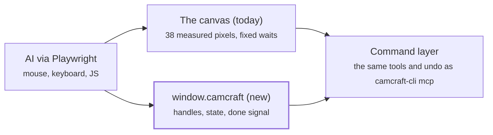

# What an AI needs to drive CamCraft through Playwright

As of 2026-11-27. Exported from the shared doc "What an AI needs to drive CamCraft through Playwright".

An AI can already drive CamCraft's browser build through Playwright, but only by clicking hard-coded pixel positions and waiting fixed times. The UI redesign can fix that with a small in-page API, the way SolidCraft's web build does: name every control, report the app's state, and say when it is done.

## At a glance



Today the AI reaches CamCraft only through the canvas. The proposal adds a second road that ends in the command layer the MCP server already uses, so nothing new has to be built underneath.

## Today: what the tests work around

CamCraft's egui UI paints everything into one `<canvas>`, and the web build has no accessibility tree. Playwright therefore sees one rectangle. The HelpCraft suite (contour manus, dovetail check, help movie) gets by with these workarounds:

| Problem | Workaround in HelpCraft | Cost |
| --- | --- | --- |
| No names for buttons, fields or tree rows | 38 hand-measured `{x, y}` points in `coords.ts`, found by screenshots | Any layout change breaks them; re-measured by hand with a calibrate spec |
| No signal that the app is done (import, generate, a dialog opening) | `settle()`: two animation frames plus a fixed wait (400–1,500 ms) | Too short = flaky, too long = slow tests and slow movies |
| No way to read app state (open dialog, selection, warnings, the operation's result) | Pixel comparisons against baseline screenshots, and parsing the downloaded G-code | Baselines break on any visual change; most state is not checked at all |
| No way to find a model edge on screen | A fixed camera view and one measured pixel on the edge | Breaks if the part, the camera or the window size changes |
| No pointer in the video (canvas apps hide the system cursor in recordings) | A fake cursor and caption banner drawn as DOM over the canvas | Works, but sits outside the app and has to be kept in sync by hand |
| Start-up only reports `#camcraft-status[data-state]` | Wait for `running`, then for the first-frame console line | Fine; this hook is the one part that already works well |

The browser also needs a real GPU: CamCraft's WebGL2 fallback panics on `noperspective` in the `viewport3d-wide` pipeline, so headless CI without a GPU cannot run it at all.

## The six things to build

All six fit in one object on the page, `window.camcraft`, that runs on the same commands, undo history and tool table as the existing `camcraft-cli mcp` server. No server and no network listener; anything that can evaluate JavaScript in the tab can use it, Playwright and Playwright MCP included.

| # | Need | What it gives the AI | SolidCraft's version | CamCraft today |
| --- | --- | --- | --- | --- |
| 1 | **Named handles**: every clickable thing reports a stable id and its screen point | Click "the Generate button", not (1156, 768). Layout changes stop breaking tests | `ui.handles` → `[{name, x, y}]`: `button:<command id>`, `tab:<name>`, `row:<label>`, panel labels | Nothing on web. AccessKit labels exist natively and are checked in `structural.rs` tests |
| 2 | **State readout**: open dialog and its fields, selection, status line, warnings, active page | Assert on facts ("60 moves, 1 warning"), not pixels; know which step it is on | `ui.inspect`, `ui.selection`; `dialog` lists the command OK would run, or what it is `waiting` for | Only the status line, painted into the canvas |
| 3 | **Done signal**: a call returns when its work is finished and the result is drawn | No fixed waits: tests get fast and stop being flaky | Every call is a promise that resolves after the UI frame; `ui.screenshot` tokens name a frame painted after a command | Nothing; HelpCraft waits a fixed time |
| 4 | **Commands from the page**: run, list and undo the same commands as the MCP server | Set up a scene in one line (load the part, add the tool) and click only the steps the test is about | `solidcraft.execute()`, `commands()` (930 commands, each with params and whether it is enabled), `request()` | The MCP tool table exists, but only on stdio or TCP, not in the browser |
| 5 | **Geometry → screen**: where a model edge, face or world point is on screen right now | Click a model edge without a fixed camera or a measured pixel | `ui.at {plane, world, sketch, dimension}`, `ui.worldToScreen`, `ui.pick` | Nothing |
| 6 | **A built-in demo pointer and captions** | Help movies show the app's own cursor gliding to the real button, with its name and a click ripple | `ui.agent_cursor {show, speed}`: glides to each command's toolbar button and names it | HelpCraft draws a fake DOM cursor and captions over the canvas |

File import already works through the `<input type=file>` the app opens (Playwright's file chooser). A path to put a file in directly, as SolidCraft's `/upload/` virtual folder does, would let the API load a part without the file dialog.

## What egui already gives you

Needs 1–3 come mostly from egui itself. Since 0.36, egui ships `egui_inspection`: a plugin that answers requests for the AccessKit widget tree, injected input, screenshots and "wait until idle". The plugin compiles for wasm; only its TCP server is native. CamCraft pins egui and eframe 0.36.2, so it is available today. Checked in the 0.36.2 sources:

| egui / eframe piece | What it does | In CamCraft's web build today | What to do |
| --- | --- | --- | --- |
| `egui_inspection::InspectionPlugin` | Requests: `GetTree` (AccessKit tree: label, role, bounds in logical points), `ApplyEvents`, `GetScreenshot`, `Resize`, `Settle` (run frames until the UI stops repainting) | Not installed | Add the plugin, plus a short `#[wasm_bindgen]` function that takes a request as JSON and returns a promise of the reply: `window.camcraft.inspect()` |
| [`egui_mcp`](https://crates.io/crates/egui_mcp) (rerun-io, 0.3.0) | MCP server over that protocol: `widget_tree`, `get_widget`, click, type, scroll, drag, keys, screenshot, resize, `wait_for` | Not usable on web (it connects over TCP) | On the desktop build: install the plugin and `egui_inspection::serve()` behind the `EGUI_INSPECTION` env var. Then `claude mcp add egui egui-mcp` drives desktop CamCraft with no browser at all |
| AccessKit labels | Names and roles for widgets | CamCraft already sets them and tests them (`structural.rs`). eframe's web runner drops the tree (`accesskit_update: _, // not currently implemented`), so Playwright's `getByRole` finds nothing | Comes back through `GetTree` once the bridge exists. Custom-painted widgets only appear if they call `response.widget_info(…)` |
| Stable ids | egui gives AccessKit nodes no author id; labels change with wording and language | None | Set one per control with `ctx.accesskit_node_builder(id, \|n\| n.set_author_id("op.generate"))`. That is the "one id per control" rule below |
| `WebRunner::app_mut::<App>()` | JavaScript-side access to the running app (needs `App::as_any_mut`) | Available | The hook for CamCraft's own commands: run an MCP tool from `window.camcraft` |
| `egui_kittest` `get_by_label` / `get_by_role` | Tree queries in Rust tests | Used in CamCraft's UI tests | HelpCraft can copy the same query style in JavaScript over `GetTree`, so both kinds of test read alike |
| eframe text agent | A hidden `<input>` that takes keyboard input | Works: Playwright typing already reaches egui | Nothing |
| `web_screen_reader` feature | Reads the focused widget aloud with speech synthesis | Off | Nothing; it adds no DOM, so Playwright gains nothing |
| `ctx.set_pixels_per_point` | Fixes the UI scale | Follows the browser | Pin it in tests so tree bounds equal CSS pixels at device scale 1 |

What egui cannot give: CamCraft's own state (operations, warnings, toolpaths), when background work such as generate is finished, geometry-to-screen for model edges, and the demo pointer. Those (needs 2 in part, 3 for background work, 4–6) stay CamCraft's own work.

## One help-movie step, before and after

The Generate step of the contour help movie as it is written today in `tests/help-contour.spec.ts`:

```ts
// coords.ts: contour.generate = { x: 1156, y: 768 }  (measured from a screenshot)
await caption(page, "Click <b>Generate</b>");
await go(page, contour.generate);   // move the fake DOM cursor, click the pixel
await settle(page, 1_500);          // hope generating is done in 1.5 s
// nothing to check except a screenshot baseline
```

The same step with the API. The names are a proposal, modelled on SolidCraft's:

```ts
const cc = (m, p) => page.evaluate(([m, p]) => window.camcraft.request(m, p), [m, p]);
await cc("ui.agent_cursor", { show: true });            // the app's own pointer
await caption(page, "Click <b>Generate</b>");
const h = await cc("ui.handles", { prefix: "button:op.generate" });
await page.mouse.click(h[0].x, h[0].y);                   // a real click, found by name
const op = await cc("ops.inspect", { op: "2D Contour1" }); // resolves when generated
expect(op.moves).toBe(60);
expect(op.warnings).toEqual([]);
```

The test still clicks the real button, so it still tests the UI. It no longer depends on where the button is or how long generating takes, and it checks the result instead of the pixels.

## Rules for the UI redesign

These cost little while the UI is being rebuilt anyway, and make both the API and plain Playwright work better:

- **One id per control, from the command it runs.** The ribbon button, the menu item and the shortcut for "Generate" all report `op.generate`. The id never changes with the label, the language or the layout.
- **Register every control in one place as it is painted.** One registry gives the handles (need 1 above), the AccessKit tree and the tests. SolidCraft records its handles while drawing each frame.
- **Every action is a command.** Whatever a button does goes through the same command table as the MCP server, so the API, MCP, undo and the UI cannot drift apart.
- **Dialogs describe themselves.** An open dialog reports its title, its fields and their values, and either the command OK would run or what it is waiting for ("pick edges first").
- **No hover-only or timing-only UI.** Nothing that only appears on hover, after a delay, or during a drag without also being reachable by a click or a command.
- **Fixed layout for a given window size.** Panel sizes and docking are saved per window size and can be reset to a known layout (`ui.layout reset`), so a test or movie always starts from the same screen.
- **Status and warnings as data.** The status line, warnings and the operation result are readable, not only painted.
- **Signal busy and done.** Background work (generate, verify, simulate) reports when it starts and ends, so a caller can wait for exactly that.
- **A WebGL2 path that starts.** Without `noperspective` in the GL pipeline, the app could run headless in CI without a GPU.

## Order to build it

Each step is useful on its own, and HelpCraft can switch over one step at a time:

1. **`window.camcraft` with `request()` and the done signal.** Install egui's `InspectionPlugin` and bridge it to the page: widget tree, input, screenshots and `Settle` come at once. Then expose the existing MCP tool table beside it; every call resolves after the frame that shows its result.
2. **Handles.** Give the ribbon, page tabs, tree rows, dialog fields and buttons a stable AccessKit author id, plus `widget_info` on custom-painted widgets. HelpCraft's `coords.ts` becomes a list of names.
3. **State readout.** Open dialog, selection, status line, warnings, operation results.
4. **Geometry to screen.** World point, edge and face to screen point, and a pick under a pixel.
5. **Demo pointer and captions.** Replaces HelpCraft's DOM overlay in help movies.
6. **WebGL2 fix.** Lets the suite and the movies run in plain CI.

SolidCraft also checks its own browser API in CI (`cargo xtask web-api-test`: start the app in headless Chrome, make a box by commands, check undo and the result). CamCraft could do the same, so the API cannot quietly break.

## Sources

- [SolidCraft browser command API](https://github.com/tangency-labs/solidcraft/blob/main/docs/browser-api.md) and [control protocol](https://github.com/tangency-labs/solidcraft/blob/main/docs/control-protocol.md) (`ui.handles`, `ui.inspect`, `ui.at`, `ui.agent_cursor`); checked live at [solidcraft.io/app](https://solidcraft.io/app), v0.50.0, on 2026-11-27
- [CamCraft](https://github.com/NeoTech/Camcraft): `crates/app/src/mcp/` (the MCP server), `crates/ui/src/egui_app/shell_web.rs` (the browser shell), `crates/ui/AGENTS.md` (AccessKit structural tests)
- HelpCraft: `tests/lib/coords.ts`, `tests/lib/camcraft.ts`, `tests/help-contour.spec.ts`
- egui 0.36.2 sources from crates.io: [`egui_inspection`](https://crates.io/crates/egui_inspection) (README, `plugin.rs`, `protocol.rs`), [`egui_mcp`](https://crates.io/crates/egui_mcp) 0.3.0 README, eframe `src/web/app_runner.rs` and `web_runner.rs` and its feature list, egui `context.rs` and `response.rs`
