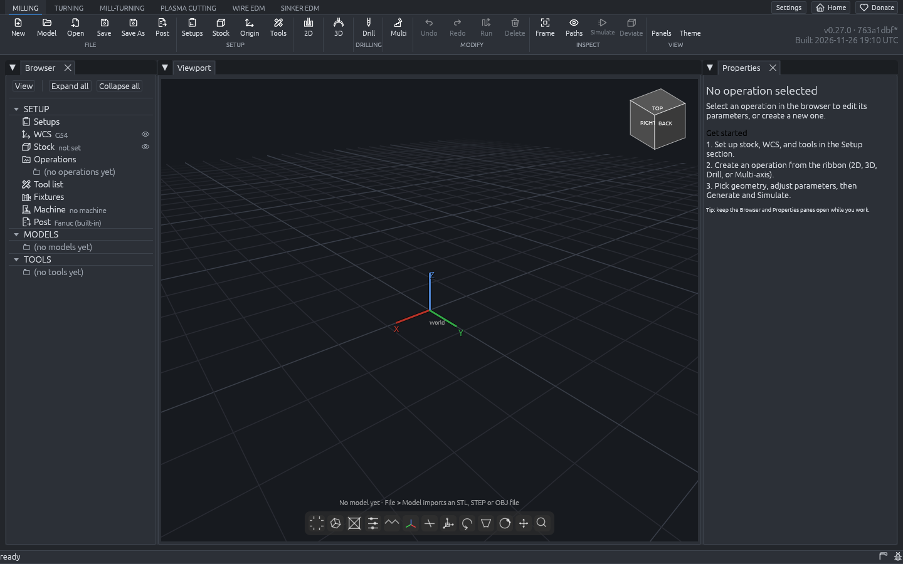

# HelpCraft

Playwright against [CamCraft](https://github.com/NeoTech/Camcraft)'s browser build, in Docker:
build any branch or PR to wasm, serve it, and drive it from a headless Chromium. Either Claude
drives it by hand (Playwright MCP), or scripted Playwright tests do.



## Pieces (`docker-compose.yml`)

| service | what it does |
|---|---|
| `build` | `docker compose run --rm build NeoTech/Camcraft main` (or `pr:4009`, or a branch). Runs CamCraft's own `web/build-app-wasm.sh --release` + `check-app-page.sh`, writes `out/<slug>/`. The source and cargo registry sit in volumes, so later builds are incremental. |
| `web` | serves `out/` at `http://localhost:8090/<slug>/` |
| `mcp` | Playwright MCP (with vision/coordinate tools) on `http://localhost:8931/mcp`, registered for Claude Code in `.mcp.json` |
| `test` | `docker compose run --rm test` runs the Playwright suite in `tests/` (`BASE_URL` picks the build) |

```sh
docker compose run --rm build NeoTech/Camcraft main   # first build is slow (full workspace to wasm)
docker compose up -d web mcp
```

## Things found the hard way

- **The GPU is required.** CamCraft draws with wgpu. In Chromium in Docker:
  - SwiftShader WebGPU (`--use-webgpu-adapter=swiftshader`) starts at 60 fps but every screenshot
    and canvas readback is plain white;
  - SwiftShader WebGL2 makes CamCraft panic: `create_render_pipeline 'viewport3d-wide'`:
    *"The selected version doesn't support Features(NOPERSPECTIVE_QUALIFIER)"* (an upstream bug
    in the WebGL2 fallback);
  - so `/dev/dri` is passed in and Chromium runs WebGPU on Vulkan (Mesa, Intel Arc/UHD).
    `RENDER_GID`/`VIDEO_GID` in `.env` (copy `.env.example`) are the host's `render`/`video` group ids.
- The `test` container runs as `HOST_UID`/`HOST_GID` (from `.env`), so `tests/node_modules` and
  the reports stay owned by you. `tests/smoke.spec.ts` checks the status div reaches `running`,
  WebGPU is present, the canvas isn't one flat colour, and the console has no panics.
- egui draws everything on one `<canvas>`, so there is no DOM to select: clicks go by coordinates
  at a fixed 1440x900 viewport. Useful DOM hooks: `#camcraft-status[data-state]`
  (`running`/`refused`), console output, and the `<input type=file>` the app opens to import models.
- Host networking is used throughout (localhost only). Port 8080 is often taken; this uses 8090.
