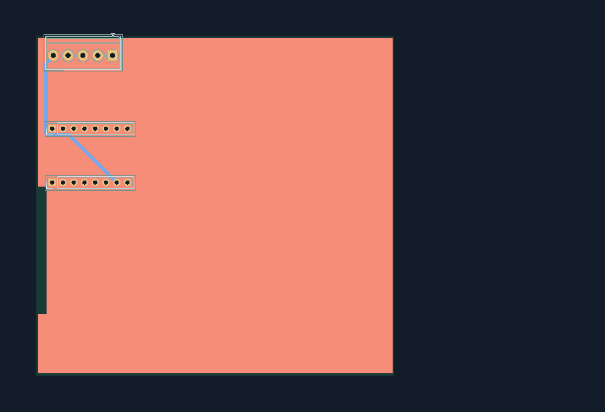

# Manus 3: placement, routing and pours

This manus gives every part its footprint and puts each one where it meets the RAMPS. Signals are routed on F.Cu
at 0.3 mm, +5V on B.Cu at 0.8 mm, and GND is poured on both layers. The reference has 120 tracks
(69 F.Cu, 51 B.Cu), no vias, and no GND tracks at all: the pours carry GND.

- Starts from: manus 2 (schematic and nets)
- Ends with: a routed board, DRC clean, no airwires
- Reference: RampsTerminalHat `board.footprints`, `board.tracks`, `board.zones`

## The worked example: X axis

| # | Do | Engine command | Check |
|---|---|---|---|
| 1 | Assign footprints. PX1 and PX2 get `Connector_PinHeader_2.54mm` → **PinHeader_1x08_P2.54mm_Vertical**. JX gets `TerminalBlock_Phoenix` → **TerminalBlock_Phoenix_PT-1,5-5-3.5-H_1x05_P3.50mm_Horizontal** | `footprint_assign {id: 2, path: "/usr/share/kicad/footprints/Connector_PinHeader_2.54mm.pretty/PinHeader_1x08_P2.54mm_Vertical.kicad_mod"}`, the same for 3 and 4 | `design_summary` lists the footprint on each part |
| 2 | **Sync to PCB** | `board_sync {}` | Three footprints (here IDs 12–14), `unassigned_components: []` |
| 3 | Move and rotate. PX1 to (3.75, 21.75) at 90°. PX2 to (3.75, 34.45) at 90°. JX to (18, 4.5) at 180° | `footprint_move {id: 12, position: {x:3.75, y:21.75}}` + `footprint_rotate {id: 12, degrees: 90}` … | PX1 and PX2 sit 12.7 mm apart, the spacing of the two rows of a driver socket. JX is at the top edge with pin 1 on the right |
| 4 | Press **X** and route the three signals on **F.Cu**, 0.3 mm: PX1.1 → JX.4, PX1.7 → JX.3, PX1.8 → JX.2 | `track_route {from: {footprint:12, pad:"1"}, to: {footprint:14, pad:"4"}, layer: "F.Cu", mode: "octilinear", width: 0.3}` … | Each answer gives track IDs and its net. `pushed: []` |
| 5 | Route **+5V** on **B.Cu**, 0.8 mm: PX2.7 → JX.5 | `track_route {from: {footprint:13, pad:"7"}, to: {footprint:14, pad:"5"}, layer: "B.Cu", mode: "octilinear", width: 0.8}` | Net +5V, 5 segments around the pads in its way |
| 6 | Pour **GND** on B.Cu and F.Cu. Use the board outline inset 0.5 mm, notch included. Thermal reliefs: 4 spokes, 0.3 mm wide, 0.25 mm gap, islands removed | `zone_place {net: 9, layer: "B.Cu", outline: [{x:0.5,y:79.5},{x:0.5,y:65.5},{x:2.5,y:65.5},{x:2.5,y:35.5},{x:0.5,y:35.5},{x:0.5,y:0.5},{x:84,y:0.5},{x:84,y:79.5},{x:0.5,y:79.5}]}`, the same for F.Cu, then `zone_pour {id, islands:"remove", pad_connect:"relief", relief_gap:0.25, spoke_width:0.3, spokes:4}` on both | `zone_fill {id}` on the B.Cu zone gives `pieces: 1, islands: 0, starved: [], spokes: 12` (three GND pads × 4) |
| 7 | Open **Checks** | `checks {}` | `drc: []`, `airwires: []`, `erc: []` |

*The X-axis slice after step 6 (the F.Cu pour is drawn on top). The 0.8 mm +5V track on B.Cu runs from PX2 up to JX.*

## Then the rest of the board

### Placement

| Ref | Footprint | X | Y | Rot |
|---|---|---|---|---|
| PX1 / PX2 | `Connector_PinHeader_2.54mm:PinHeader_1x08_P2.54mm_Vertical` | 3.75 | 21.75 / 34.45 | 90 |
| PY1 / PY2 | 〃 | 24.07 | 21.75 / 34.45 | 90 |
| PZ1 / PZ2 | 〃 | 44.39 | 21.75 / 34.45 | 90 |
| PA1 / PA2 | 〃 | 3.115 | 44.61 / 57.31 | 90 |
| PEVCC / PEGND / PES | `Connector_PinSocket_2.54mm:PinSocket_1x06_P2.54mm_Vertical` | 46.295 | 57.786 / 60.326 / 62.866 | 90 |
| PAUX2 | `Connector_PinSocket_2.54mm:PinSocket_2x05_P2.54mm_Vertical` | 45.66 | 11.749 | 90 |
| JX / JY | `TerminalBlock_Phoenix:TerminalBlock_Phoenix_PT-1,5-5-3.5-H_1x05_P3.50mm_Horizontal` | 18 / 38.5 | 4.5 | 180 |
| JAUX | `TerminalBlock_Phoenix:TerminalBlock_Phoenix_PT-1,5-10-3.5-H_1x10_P3.50mm_Horizontal` | 75.5 | 4.5 | 180 |
| JZ | 5-pole terminal, as JX | 80 | 32 | 90 |
| JA | 5-pole terminal, as JX | 4 | 75.5 | 0 |
| JESX / JESY / JESZ | `TerminalBlock_Phoenix:TerminalBlock_Phoenix_PT-1,5-6-3.5-H_1x06_P3.50mm_Horizontal` | 22 / 43.5 / 65 | 75.5 | 0 |

How the layout reads: the **headers** are fixed by the RAMPS. The driver sockets are 20.32 mm apart in X
(X, Y, Z in a row; E0 under X, shifted 0.635 mm). Each socket's two rows are 12.7 mm apart. The three endstop rows
are 2.54 mm apart. The **terminals** go round the edges: 3 at the top, 1 on the right, 4 at the bottom. Their wires
then leave the board outwards.

### Routing order

1. **Signals on F.Cu, 0.3 mm**, one net at a time, shortest first: the endstops (PES → JESx), the step, dir
   and EN lines, then AUX-2 (PAUX2 → JAUX). Use `mode: "octilinear"`. Where a route is boxed in, use `octilinear_shove`. It
   pushes tracks already laid aside, within limits.
2. **+5V on B.Cu, 0.8 mm**: every terminal's 5V pin back to the nearest PX2/PY2/PZ2/PA2 pin 7 or PEVCC.
3. **GND**: no tracks. The two pours of step 6 connect every GND pad through thermal reliefs.

Run `checks {copper_only: true}` after every few nets. It is quick and reports only copper: clearance,
width and unrouted.

## Check the stage

- `board_statistics`: 20 footprints, tracks on F.Cu and B.Cu, 0 vias, 2 poured zones.
- `checks`: `drc: []` and `airwires: []`.
- `zone_fill` on both zones: `starved: []`, so every GND pad is reached.

## Things to know

- **Footprint moves don't drag copper.** Place first, route after. If you move a part later, use
  `net_unroute` on its nets and route them again.
- **Orthogonal mode doesn't avoid anything.** The default `track_route` mode makes one right-angle bend
  straight through other copper. Use `octilinear` and the router walks round other nets' pads and tracks.
- **One signal layer, one power layer, no vias.** All signals on top and all +5V on the bottom never cross,
  so the board needs no vias. That keeps a through-hole hat cheap and easy to repair.
- **The pour goes last.** A pour placed before the tracks gets cut up around them as you route.
  Fill it once the copper is done and look at `zone_fill` for islands and starved pads.
- On the real board, the **headers are fitted on the bottom side** and soldered from the top (manus 4).
  The footprints stay on the top side in the design. Through-hole pads are the same on both sides.
