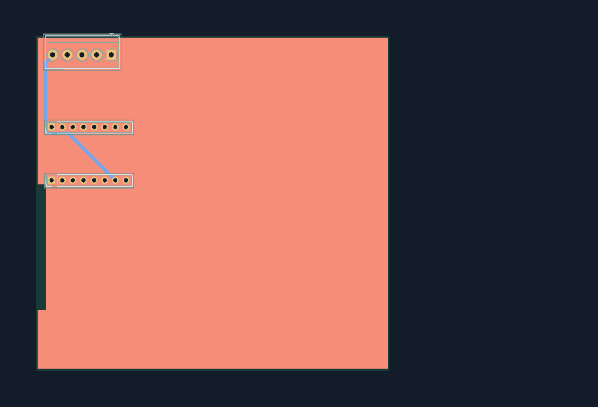

# PCBCraft manuses: build the RampsTerminalHat

Four manuses that take you through making a real board in [PCBCraft](https://github.com/wdunn001/pcbcraft), step by step.
The reference is [bnegt/RampsTerminalHat](https://github.com/bnegt/RampsTerminalHat), a screw-terminal hat for a RAMPS 1.4.
It was made entirely with PCBCraft. Every number here comes from its design file,
`hardware/RampsTerminalHat.pcbcraft`, so you can compare your board with it at each stage.

| # | Manus | You end with | Steps |
|---|---|---|---|
| 1 | [Board outline](1-board-outline.md) | An 84.5 × 80 mm board with the MOSFET notch and the M3 hole | 4 |
| 2 | [Schematic and nets](2-schematic-nets.md) | 20 connectors, 28 nets, two net classes, a clean ERC | 6 |
| 3 | [Placement, routing and pours](3-placement-routing.md) | Footprints in place, signals routed on F.Cu and 5 V on B.Cu, GND poured, a clean DRC | 7 |
| 4 | [Fabrication outputs](4-fabrication.md) | Gerbers, drills, a JLCPCB zip, a BOM and a fit check | 6 |

Each manus takes over from where the one before it ends. Do them in order on one design and save
after each one (`.pcbcraft`).

## How to read a manus

Each step has three parts:

- **Do:** what you do, with the keys and buttons from PCBCraft's
  [getting-started](https://github.com/wdunn001/pcbcraft/blob/main/docs/getting-started.md).
- **Engine command:** the same step as a PCBCraft engine command. You can run it through the MCP server
  (`pcbcraft-cli mcp`), in a `pcbcraft-cli run` script, or have Claude run it.
- **Check:** what must be true before you go on, and how to see it.

The worked example is the **X axis**: PX1 and PX2 into the X driver socket, out to the JX terminal. It is
small enough to do by hand. The tables in manuses 2 and 3 then hold the other 17 connectors,
to repeat the same way.

## Verified

The engine commands for the X-axis slice were run start to finish against PCBCraft through its MCP server on
2026-11-27. The ERC, DRC and airwire lists all came back empty. The Gerber README reported
84.500 × 80.000 × 1.600 mm, with the same drill sizes as the reference. The result is saved here as
[`x-axis-slice.pcbcraft`](x-axis-slice.pcbcraft):

The desktop keys and buttons are from PCBCraft's own docs. They were not clicked through in a test.

## Conventions

- Millimetres, board origin top left, **Y grows downward** (the screenshot above: JX at y = 4.5 is at the top).
- Component IDs in the engine commands (`component: 2`, `footprint: 12`) are what *your* design returns.
  Each command answers with the new ID, so use that ID instead of the one printed here.
- Library paths are the KiCad libraries PCBCraft finds on the host (`library_catalog`), here
  `/usr/share/kicad/symbols/…` and `/usr/share/kicad/footprints/…`.
